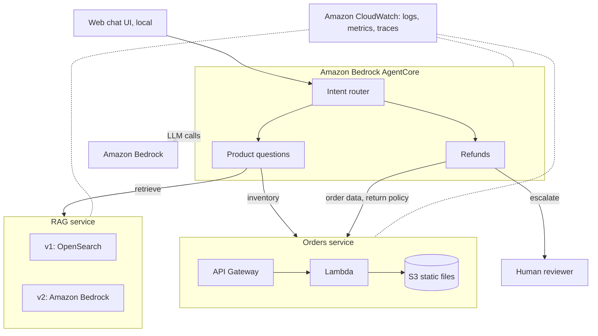

# Customer Service Agent: Architecture

Nov 11, 2026 · @Liliana Badillo

## Overview and goals

A customer service agent for a hair care products company, deployed entirely on AWS with Terraform. The project has three goals:

1. **Build the agent:** a working customer service agent that detects intent, answers product questions with RAG, and handles refund requests with escalation to a human.
2. **Compare two RAG variants:** measure OpenSearch and Amazon Bedrock on retrieval quality, answer quality, latency and cost, and pick the better one.
3. **Measure the whole system:** track cost per conversation, p50 and p95 latency, and other metrics still to be decided.

**What it does**

- Detects the user's intent, then routes to the right agent.
- Answers product questions using the RAG service, a tool the agents call.
- Handles refund requests and escalates them to a human.
- Reads order status and inventory through the orders service, another tool the agents call.

**Scope decisions**

- The orders service runs as Lambda, the rest on managed AWS services.
- The web chat UI runs locally and is not deployed.
- One environment only; there is no dev/prod split.
- Model routing and a monitoring dashboard are out of scope for now (see Roadmap).
- Guardrails (cost limits for now: max request length, max tokens, `recursion_limit`) apply to every conversation.

## Tech stack

| Area | Technology |
| --- | --- |
| Programming Language | Python 3.13 |
| Agent orchestration | LangGraph |
| Agent runtime | AgentCore |
| LLMs (response generation) | Amazon Bedrock |
| RAG regression testing | RAGAS |
| RAG variants | OpenSearch, Amazon Bedrock |
| Orders service | AWS Lambda, API Gateway, S3 |
| Observability | Amazon CloudWatch, OpenTelemetry |
| Infrastructure | Terraform |

## System diagram and components

The local UI talks to the intent router agent, which hands off to the product questions agent or the refunds agent. The product questions agent calls the RAG service (either variant) and the Orders service for inventory. The refunds agent calls the Orders service and escalates cases to a human reviewer. Amazon Bedrock provides the LLMs that generate the agents' responses.



## Agents

Three agents run on AgentCore: one classifies intent and hands off, one answers product questions through RAG, and one handles refunds and escalates to a human.

| Agent | Role | Tools | Output |
| --- | --- | --- | --- |
| Intent router | Detects what the user wants and hands off | None | Intent label + handoff |
| Product questions | Answers product questions | RAG service, Orders service (inventory) | Grounded answer with sources |
| Refunds | Checks the order and refund policy, then escalates | Orders service (order details, return policy) | Case summary for a human |

Agents never call AWS services directly. They go through thin clients (`rag_client`, `orders_client`), so the logic is testable with mocks and either RAG variant can be swapped in through the RAG\_VARIANT setting.

The refunds agent does not issue refunds. It gathers the order details, checks eligibility against the policy and hands a case summary to a human for approval.

**Memory:** the agents use short-term memory within a conversation and long-term memory across conversations. The design of each is still to be decided.

**Models:** each agent can run on a different model. Which model each agent uses is still to be decided.

## RAG service

One service exposes a single retrieval contract and two interchangeable backends, so the agents and the evaluation harness never know which variant they are calling.

|  | v1: OpenSearch | v2: Amazon Bedrock |
| --- | --- | --- |
| Vector store | Amazon OpenSearch | Managed by Bedrock Knowledge Bases (assumed) |
| Ingestion | Own pipeline: load, chunk, embed, index | Knowledge Base sync from S3 |
| Control over retrieval | High (chunking, hybrid search, reranking) | Limited to what the service exposes |
| Operational effort | Higher | Lower |

Both variants read the same source documents (product catalog, FAQs) from S3 and implement the same `Retriever` interface. The variant is selected by an environment variable, `RAG_VARIANT` (`v1` or `v2`), which Terraform sets for the deployed system and the evals override per run.

The variants differ in chunking strategy, ranking and other dimensions still to be decided. Cost and latency are measured for both variants, alongside retrieval and answer quality.

To keep the comparison meaningful, the differences between the variants should be written down before measuring, so each result can be traced to its cause.

## Orders service

A Lambda function behind API Gateway serves order status and inventory from static files stored in S3. It is adapted from starter code in an [AWS tutorial](https://builder.aws.com/content/3HS7p4Dme6C7ZXTZTq0Edy2NzPB/what-is-langgraph-a-beginners-guide-to-ai-agents-on-amazon-bedrock).&#32;

- **Reads:** order status by order ID, inventory by product.

* **Data:** static order and inventory files in an S3 bucket, loaded by the function.
* **Callers:** the refunds agent (order details) and the product questions agent (inventory questions).
* **Writes:** apply\_refund may write refund data.

The starter code, taken from the [AWS tutorial on LangGraph and Amazon Bedrock](https://builder.aws.com/content/3HS7p4Dme6C7ZXTZTq0Edy2NzPB/what-is-langgraph-a-beginners-guide-to-ai-agents-on-amazon-bedrock), defines five endpoints:

- `return_policy`
- `get_order`
- `refund_status`
- `refund_amount`
- `apply_refund`
- `get_product_inventory`

## RAG evaluation plan

Both variants run against the same golden question set, and one script writes a single results table with four metrics.

| Metric | What it measures | How |
| --- | --- | --- |
| Retrieval quality | Whether the right passages come back | Recall@k, MRR or hit rate against labelled source documents |
| Answer quality | Whether answers are correct and grounded | Faithfulness and relevance, scored with RAGAS and LLM-as-judge evals on the same questions |
| Latency | Response time | p50 and p95 per variant |
| Cost | What each variant costs to run | Per-query cost plus fixed monthly cost (e.g. OpenSearch capacity vs Bedrock usage) |

**Golden set:** questions about products, ingredients and usage, each with an expected answer and expected source documents. It lives in the repo under `data/eval/`.

**Decision rule:** agree on the weighting before running (for example, quality first, then cost, then latency), so the choice is not made after seeing the numbers.

**Experiment setup:** both variants index the same source documents and answer the same golden set. Each question runs several times so latency numbers are stable, and results are saved per run under `evals/results/` so the variants can be compared over time.

**Regression testing:** RAGAS runs in the CI/CD pipeline on the golden set against each variant whenever the RAG code, prompts or documents change, so drops in retrieval or answer quality are caught early.

## System evaluation plan

The whole system is also evaluated end to end, on full conversations rather than single retrievals.

| Metric | What it measures | How |
| --- | --- | --- |
| Cost per conversation | Total cost of one full conversation | Sum of model, retrieval and service costs per conversation |
| p50 latency | Typical response time | Median end-to-end time per user turn |
| p95 latency | Slow-case response time | 95th percentile end-to-end time per user turn |
| Other metrics | To be decided | To be decided |

**Scenarios:** scripted conversations covering product questions, inventory questions and refund requests, run through the intent router and the agents with each RAG variant.

## Infrastructure (Terraform)

One Terraform root in `infra/`, one environment, with a module per service. The RAG module is instantiated once per variant.

| Module | Provisions |
| --- | --- |
| `orders` | S3 bucket for static data, Lambda function, API Gateway, IAM roles |
| `rag` (v1) | OpenSearch domain or collection, ingestion resources, IAM |
| `rag` (v2) | Bedrock Knowledge Base, S3 source bucket, IAM |
| `agents` | AgentCore runtime and agents, IAM for Bedrock model access |

- **State:** remote backend in S3.
- **Packaging:** the orders Lambda ships as a zip built by a script; no containers.
- **Outputs:** endpoints and IDs the local UI and the evaluation scripts read from `terraform output`.
- **Cost control:** OpenSearch has a fixed running cost, so destroy it when not measuring.
- **Variant selection:** Terraform sets the `RAG_VARIANT` environment variable (`v1` or `v2`) on the RAG service.

## Guardrails

Guardrails limit what the system can cost and do. New ones, such as security guardrails, are added as rows in the table below. The values are still to be decided.

| Guardrail | Type | What it limits |
| --- | --- | --- |
| Max request length | Cost | How long a user request can be |
| Max tokens | Cost | How many tokens the LLM can generate per call |
| `recursion_limit` | Cost | How many steps an agent graph can take in one run, which stops loops |

## Observability

Everything is observed in Amazon CloudWatch. AgentCore already provides built-in metrics, logs and traces there, and LangGraph can send OpenTelemetry traces through the AWS Distro for OpenTelemetry ([AWS docs](https://docs.aws.amazon.com/AmazonCloudWatch/latest/monitoring/AgentCore-GettingStarted.html)). Enable CloudWatch Transaction Search once to see traces.

| Layer | What to capture | How |
| --- | --- | --- |
| Agents and LLM calls | One trace per conversation: graph steps, LLM calls, tool calls, token counts | AgentCore observability plus OpenTelemetry tracing in LangGraph, viewed in CloudWatch GenAI observability |
| Orders service | Requests, errors, duration | Lambda and API Gateway logs and metrics |
| RAG service | Retrieval latency and errors, per variant | Structured logs and custom metrics tagged with the variant |
| Cost and latency | Cost per conversation, p50 and p95 latency | Computed from traces and token usage; feeds the system evaluation and the Roadmap dashboard |

## Repo structure&#32;

```
haircare-support-agent/
├── data/            eval/ (golden set), knowledge_base/, orders_seed/
├── docs/            architecture, decision records, rag-evaluation
├── evals/           agents/, rag/ (experiment runner, compare), results/, system/ (cost, latency)
├── frontend/        local web chat (not deployed)
├── infra/           main.tf, variables.tf, outputs.tf, modules/{agents,orders,rag}
├── scripts/         ingest_kb, package_lambda, smoke_test
└── services/
    ├── agents/      intent_router/, product_qa/, prompts/, refunds/, tools/
    ├── orders/      Lambda handler (starter code)
    └── rag/         core/ (Retriever), ingestion/, variants/ (bedrock, opensearch)
```

## Roadmap

Planned after the first working version:

- **Model routing:** a module that chooses which Amazon Bedrock model handles each request.
- **Monitoring dashboard:** a dashboard to watch the running system.
- **Security:** additional guardrails that protect the system from attacks, added to the Guardrails table.

## Sources

- [What is LangGraph? A Beginner's Guide to AI Agents on Amazon Bedrock](https://builder.aws.com/content/3HS7p4Dme6C7ZXTZTq0Edy2NzPB/what-is-langgraph-a-beginners-guide-to-ai-agents-on-amazon-bedrock): AWS tutorial the orders service starter code comes from.
