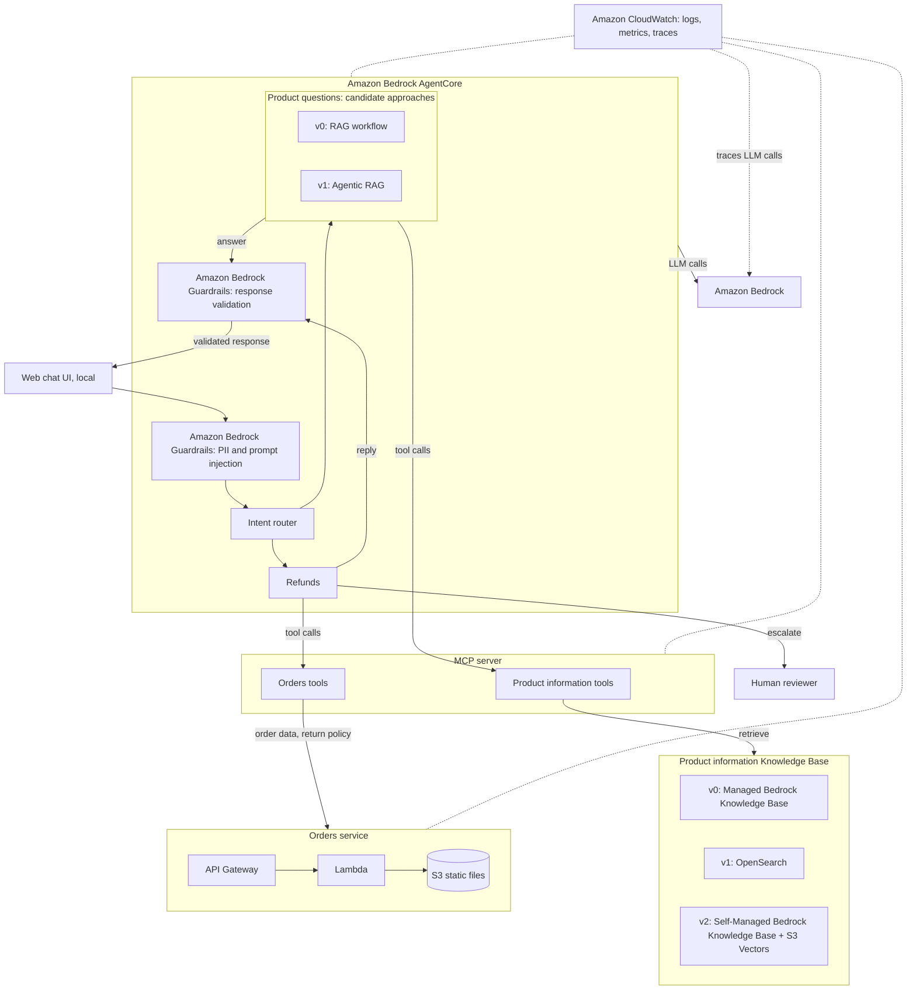

# Customer Service Agent: Architecture

Nov 11, 2026 · Last updated Nov 25, 2026 · @Liliana Badillo

## Overview and goals

A customer service agent for a hair care products company, deployed entirely on AWS with Terraform. The project has three goals:

1. **Build the agents:** a working customer service agent team that detects intent, answers product questions with RAG, and handles refund requests with escalation to a human.
2. **Compare the product information component:** measure the two candidate product questions approaches, v0 (simple RAG workflow) and v1 (agentic RAG), each run against the three Knowledge Base variants: v0 (managed Bedrock Knowledge Base), v1 (OpenSearch) and v2 (self-managed Bedrock Knowledge Base with S3 Vectors). Compare them on retrieval quality, answer quality, latency and cost, and pick the best combination.

3. **Measure the whole system:** track cost per conversation, p50 and p95 latency, and tokens.

**What it does**

- Detects the user's intent, then routes to the right agent.
- Answers product questions using the product information Knowledge Base (KB), a tool the product questions component calls.
- Handles refund requests and escalates them to a human.
- Reads order details and return policy through the orders service, a tool the refunds agent calls.

**Scope decisions**

- The orders service runs as Lambda, the rest on managed AWS services.
- The web chat UI runs locally and is not deployed.
- One environment only; there is no dev/prod split.
- Model routing and a monitoring dashboard are out of scope for now (see Roadmap).
- Guardrails (cost limits for now: max request length, max tokens, `recursion_limit`) apply to every conversation.

## Tech stack

| Area | Technology |
| --- | --- |
| Programming Language | Python 3.13 |
| Agent orchestration | LangGraph |
| Agent runtime | AgentCore |
| LLMs (response generation) | Amazon Bedrock |
| Guardrails (security) | Amazon Bedrock Guardrails |
| RAG regression testing | RAGAS |
| Product information KB variants | Amazon Bedrock Knowledge Bases (managed, v0), Amazon OpenSearch Service (v1), Amazon Bedrock Knowledge Bases with Amazon S3 Vectors (self-managed, v2) |
| Embeddings | Amazon Titan Text Embeddings V2 |
| Orders service | AWS Lambda, API Gateway, S3 |
| Observability | Amazon CloudWatch, OpenTelemetry, LangSmith |
| Infrastructure | Terraform |

## System diagram and components

The local UI sends each user message through an input guardrail, implemented with Amazon Bedrock Guardrails, which checks for PII and prompt injection before it reaches the intent router agent. The router hands off to the product questions component or the refunds agent. Their replies pass through an output guardrail, also implemented with Amazon Bedrock Guardrails, which validates the response before it reaches the UI. The product questions component is one of two candidate approaches (v0: RAG workflow, v1: agentic RAG), to be chosen from the experiments. It retrieves from the product information KB, which has three interchangeable variants (v0, v1, v2), and generates the answer. The MCP server has two groups of tools: product information tools, which the product questions component uses to reach the product information KB, and orders tools, which the refunds agent uses to reach the orders service. The refunds agent also escalates cases to a human reviewer. Amazon Bedrock provides the LLMs that generate the agents' responses. Amazon CloudWatch collects logs, metrics and traces from AgentCore and the Orders service, and traces the LLM calls to Amazon Bedrock.



## Agents

Two agents are fixed: one classifies intent and hands off, and one handles refunds and escalates to a human. The product questions component is not fixed yet. It will be one of two candidate approaches (v0 or v1), chosen from the experiments.

| Agent | Role | Tools | Output |
| --- | --- | --- | --- |
| Intent router | Detects what the user wants and hands off | None | Intent label + handoff |
| Product questions (v0 or v1, to be chosen by experiment) | Answers product questions | Product information KB | Grounded answer with sources |
| Refunds | Checks the order and refund policy, then escalates | Orders service (order details, return policy) | Case summary for a human |

Agents never call AWS services directly. They go through thin clients (`rag_client`, `orders_client`), which call the MCP server's tools, so the logic is testable with mocks and any KB variant can be swapped in through the `RAG_VARIANT` setting.

The refunds agent does not issue refunds. It gathers the order details, checks eligibility against the policy and hands a case summary to a human for approval.

**Memory:** short-term memory within a conversation is the message list in the graph state, saved between turns with the AgentCore Memory service (see [ADR: Agent graph architecture](adr/agentic_graph.md)). Long-term memory across conversations is not decided yet; it is a first version only if time allows.

**Models:** each agent runs on its own model. The intent router uses Amazon Nova Lite. The product questions component and the refunds agent use Claude Sonnet 5.5 (see [ADR: Agent graph architecture](adr/agentic_graph.md)).

### Product questions: candidate approaches

The product questions component has two candidate approaches. Only one will be kept, and the choice is made from the experiments, not decided up front. Both use the product information KB as their only tool.

| Version | Approach | How it works |
| --- | --- | --- |
| v0 | Simple RAG workflow | A fixed pipeline: retrieve passages for the question, then generate the answer from them. The model does not decide whether or what to retrieve. |
| v1 | Agentic RAG | The model decides whether and what to retrieve, can rephrase the query and retrieve again, then answers from the results. |

These labels are separate from the KB variants (`v0`, `v1`, `v2`): either approach can run against any KB variant. How the two approaches are compared (metrics, golden set, cost, decision rule) is still to be decided.

## Product information Knowledge Base

The product information KB is the RAG service the product questions component retrieves from. It exposes a single retrieval contract and three interchangeable variants, so the agents and the evaluation harness never know which variant they are calling.

|  | v0: Managed Bedrock Knowledge Base | v1: OpenSearch | v2: Self-managed Bedrock Knowledge Base + S3 Vectors |
| --- | --- | --- | --- |
| Vector store | Managed by the Bedrock Knowledge Base setup | Amazon OpenSearch Service | Amazon S3 Vectors, attached to a Bedrock Knowledge Base |
| Ingestion | Knowledge Base sync from S3 with the service's default settings | Own pipeline: embed and index the shared chunks | Knowledge Base sync from S3, with `chunkingStrategy: NONE` (each file is one chunk) |
| Control over retrieval | Lowest: service defaults | High (chunking, hybrid search, reranking) | Limited to what the service exposes; semantic search only on S3 Vectors |
| Operational effort | Lowest | Higher | Lower |

All three variants implement the same `Retriever` interface. The variant is selected by an environment variable, `RAG_VARIANT` (`v0`, `v1` or `v2`), which Terraform sets for the deployed system and the evals override per run.

**Why S3 Vectors for v2:** a Knowledge Base doesn't store vectors itself; it needs an attached vector store. S3 Vectors is billed per use, so it costs almost nothing when idle, and it is a different backend from v1. With OpenSearch Serverless or an OpenSearch managed cluster, both variants would run on OpenSearch and the comparison would mostly disappear. Serverless also bills a minimum capacity even when idle.

### Experiment design

The comparison between v1 and v2 is a controlled experiment: the only thing that changes between them is the retrieval platform. v0 is not part of this experiment, because it keeps the managed Knowledge Base's default settings. All other RAG parameters are fixed to options both services can implement the same way. They were chosen in `notebooks/02_rag_experiment_design.ipynb` and are frozen in `evals/rag/experiment_config.json`, which the v1 ingestion, the v2 Terraform and the eval runner all read.

| Parameter | Value | Why |
| --- | --- | --- |
| Chunking | One chunk per `##` markdown section, produced by our own chunker | The only way to give both variants identical chunks. It also scored best on the seed eval set (MRR 1.000, against 0.852 for 300-token windows like the Knowledge Base default) |
| How v2 gets the chunks | One S3 file per chunk, plus a `.metadata.json` sidecar; Knowledge Base chunking set to `NONE` | The Knowledge Base's own chunkers can't be reproduced exactly in v1 |
| Chunk metadata | `doc_id`, `chunk_id`, `title`, `section` | `rag_client` adds `"<title> \| <section>"` to each passage it gives the LLM, because section chunks don't name their product |
| Embedding model | Amazon Titan Text Embeddings V2, 1024 dimensions, normalised | Supported by both; at about 80 chunks, size doesn't affect cost |
| Retrieval mode | Semantic (k-NN), cosine distance, no reranking | S3 Vectors is semantic-only, and the Knowledge Base's hybrid score fusion can't be configured. Hybrid gave no gain on this corpus |
| top-k | 3 | Recall reached 1.0 at k=2; 3 leaves room for questions that compare products |
| Answer generation | Same model, prompt and temperature 0 for both variants | Still to be decided (Day 3) |

**What the result should look like:** with these parameters fixed, both variants run cosine search over the same vectors, so retrieval quality should come out about equal. The comparison is then decided mainly by cost, latency and operational effort. A large quality gap would point to a setup bug rather than a real difference.

**Differences that come with the platform:** these can't be removed, so they are the first suspects when results differ. Each variant uses its own approximate index (Lucene HNSW in v1, S3 Vectors' index in v2). In v1 our code calls the embedding model; in v2 the Knowledge Base does, inside its retrieve call. The Knowledge Base also parses the markdown files itself, and its scores use a different scale, so results are compared by rank, never by raw score.

## Orders service

A Lambda function behind API Gateway serves order status and inventory from static files stored in S3. It is adapted from starter code in an [AWS tutorial](https://builder.aws.com/content/3HS7p4Dme6C7ZXTZTq0Edy2NzPB/what-is-langgraph-a-beginners-guide-to-ai-agents-on-amazon-bedrock).&#32;

- **Reads:** order status by order ID, inventory by product.

* **Data:** static order and inventory files in an S3 bucket, loaded by the function.
* **Callers:** the refunds agent only. The product questions component has no access to this service for now.
* **Writes:** apply\_refund may write refund data.

The starter code, taken from the [AWS tutorial on LangGraph and Amazon Bedrock](https://builder.aws.com/content/3HS7p4Dme6C7ZXTZTq0Edy2NzPB/what-is-langgraph-a-beginners-guide-to-ai-agents-on-amazon-bedrock), defines six endpoints:

- `return_policy`
- `get_order`
- `refund_status`
- `refund_amount`
- `apply_refund`
- `get_product_inventory` (no caller for now, since the product questions component no longer has access)

## RAG evaluation plan

All three KB variants run against the same golden question set, and one script writes a single results table with four metrics.

| Metric | What it measures | How |
| --- | --- | --- |
| Retrieval quality | Whether the right passages come back | Recall@k, MRR or hit rate against labelled source documents |
| Answer quality | Whether answers are correct and grounded | Faithfulness and relevance, scored with RAGAS and LLM-as-judge evals on the same questions |
| Latency | Response time | p50 and p95 per variant |
| Cost | What each variant costs to run | Per-query cost plus fixed monthly cost (e.g. OpenSearch capacity vs Bedrock usage) |

**Golden set:** questions about products, ingredients and usage, each with an expected answer and expected source documents. It lives in the repo under `data/eval/`.

**Decision rule:** agree on the weighting before running (for example, quality first, then cost, then latency), so the choice is not made after seeing the numbers.

**Experiment setup:** v1 and v2 index the same chunk files and use the parameters in `evals/rag/experiment_config.json` (see Experiment design above); v0 uses the managed Knowledge Base's defaults. All three answer the same golden set. Each question runs several times so latency numbers are stable, and results are saved per run under `evals/results/` so the variants can be compared over time. If the spec has to change, bump its `version` and rerun v1 and v2, so results from different specs are never compared.

**Hypothesis:** v1 and v2 reach the same retrieval quality within noise (an MRR difference smaller than one question), v2 costs less per month and needs less operational work, and p50 latencies differ by less than 100 ms.

**Parity check:** run this first, before measuring. For each golden question, compare the top-k `chunk_id`s v1 and v2 return. The mean overlap (intersection over union) should be at least 0.9. Investigate every question where the first result differs, starting by comparing the chunk text v2 stored with the file it came from.

**Regression testing:** RAGAS runs in the CI/CD pipeline on the golden set against each variant whenever the RAG code, prompts or documents change, so drops in retrieval or answer quality are caught early.

## System evaluation plan

The whole system is also evaluated end to end, on full conversations rather than single retrievals.

| Metric | What it measures | How |
| --- | --- | --- |
| Cost per conversation | Total cost of one full conversation | Sum of model, retrieval and service costs per conversation |
| p50 latency | Typical response time | Median end-to-end time per user turn |
| p95 latency | Slow-case response time | 95th percentile end-to-end time per user turn |
| Other metrics | To be decided | To be decided |

**Scenarios:** scripted conversations covering product questions and refund requests, run through the intent router and the agents with each KB variant and each product questions approach.

## Infrastructure (Terraform)

One Terraform root in `infra/`, one environment, with a module per service. The RAG module is instantiated once per variant.

| Module | Provisions |
| --- | --- |
| `orders` | S3 bucket for static data, Lambda function, API Gateway, IAM roles |
| `rag` (v0) | Managed Bedrock Knowledge Base with default settings, S3 source bucket, IAM |
| `rag` (v1) | OpenSearch domain, ingestion resources, IAM |
| `rag` (v2) | Bedrock Knowledge Base (chunking `NONE`), S3 Vectors bucket and index (1024 dimensions, cosine), S3 source bucket of chunk files, IAM |
| `agents` | AgentCore runtime and agents, IAM for Bedrock model access |

- **State:** remote backend in S3.
- **Packaging:** the orders Lambda ships as a zip built by a script; no containers.
- **Outputs:** endpoints and IDs the local UI and the evaluation scripts read from `terraform output`.
- **Cost control:** OpenSearch has a fixed running cost, so destroy it when not measuring.
- **Variant selection:** Terraform sets the `RAG_VARIANT` environment variable (`v0`, `v1` or `v2`) on the product information KB.

## Guardrails

Guardrails limit what the system can cost and do. New ones, such as security guardrails, are added as rows in the table below. The values are still to be decided.

| Guardrail | Type | What it limits |
| --- | --- | --- |
| Max request length | Cost | How long a user request can be |
| Max tokens | Cost | How many tokens the LLM can generate per call |
| `recursion_limit` | Cost | How many steps an agent graph can take in one run, which stops loops |
| PII and prompt injection (input), Amazon Bedrock Guardrails | Security | User messages that contain personal data or prompt injection attempts, before they reach the agents |
| Response validation (output), Amazon Bedrock Guardrails | Security | Agent replies before they reach the user |

## Observability

Everything is observed in Amazon CloudWatch, and the agents' traces are also sent to LangSmith. AgentCore already provides built-in metrics, logs and traces there, and LangGraph can send OpenTelemetry traces through the AWS Distro for OpenTelemetry ([AWS docs](https://docs.aws.amazon.com/AmazonCloudWatch/latest/monitoring/AgentCore-GettingStarted.html)). Enable CloudWatch Transaction Search once to see traces. Every LLM call the agents make to Amazon Bedrock is traced in CloudWatch.

| Layer | What to capture | How |
| --- | --- | --- |
| Agents and LLM calls to Amazon Bedrock | One trace per conversation: graph steps, LLM calls, tool calls, token counts | AgentCore observability plus OpenTelemetry tracing in LangGraph, viewed in CloudWatch GenAI observability and in LangSmith |
| MCP server | Tool calls, errors, duration per tool | Structured logs and CloudWatch metrics, per tool |
| Orders service | Requests, errors, duration | Lambda and API Gateway logs and metrics |
| Product information KB | Retrieval latency and errors, per variant | Structured logs and custom metrics tagged with the variant |
| Cost and latency | Cost per conversation, p50 and p95 latency | Computed from traces and token usage; feeds the system evaluation and the Roadmap dashboard |

## Repo structure&#32;

```
haircare-support-agent/
├── data/            eval/ (golden set), knowledge_base/, orders_seed/
├── docs/            architecture, decision records, rag-evaluation
├── evals/           agents/, rag/ (experiment_config.json, experiment runner, compare), results/, system/ (cost, latency)
├── frontend/        local web chat (not deployed)
├── infra/           main.tf, variables.tf, outputs.tf, modules/{agents,orders,rag}
├── notebooks/       01 RAG v1 exploration, 02 RAG experiment design
├── scripts/         ingest_kb, package_lambda, smoke_test
└── services/
    ├── agents/      intent_router/, product_information/, prompts/, refunds/, tools/
    ├── orders/      Lambda handler (starter code)
    └── rag/         core/ (Retriever), ingestion/, variants/ (bedrock, opensearch)
```

## Roadmap

Planned after the first working version:

- **Model routing:** a module that chooses which Amazon Bedrock model handles each request.
- **Monitoring dashboard:** a dashboard to watch the running system.
- **Security:** additional guardrails that protect the system from attacks, added to the Guardrails table.

## History

Changes to this document and the decisions behind them, newest first. Add a row whenever a design decision changes. Larger decisions get their own record in `docs/adr/`, linked from the row.

| Date | Change | Why / where it was decided |
| --- | --- | --- |
| 2026-11-25 | Agents section now records the short-term memory design (graph state, AgentCore Memory checkpointer), and the models per agent (Amazon Nova Lite for the router, Claude Sonnet 5.5 for product questions and refunds). Long-term memory is still open | Decided in [ADR: Agent graph architecture](adr/agentic_graph.md) |
| 2026-11-25 | The input and output security guardrails are implemented with Amazon Bedrock Guardrails. Added it to the tech stack, the diagram labels, the system description and the Guardrails table | Decided in [ADR: Agent graph architecture](adr/agentic_graph.md) |
| 2026-11-25 | Moved the input and output guardrails inside the AgentCore subgraph in the diagram, so they are graph nodes. The agent graph design is recorded in the new ADR | Decided in [ADR: Agent graph architecture](adr/agentic_graph.md) |
| 2026-11-25 | Added LangSmith as an agent tracing tool, alongside CloudWatch. Added it to the tech stack, the observability intro and the agents and LLM calls row | LangSmith is in scope for the Day 5 plan (agent tracing, with CloudWatch) |
| 2026-11-25 | Added two guardrail components to the system diagram: an input guardrail between the web chat UI and the intent router (PII and prompt injection), and an output guardrail between the agents and the web chat UI (response validation). Both agents' replies now pass through the output guardrail before reaching the UI | Added to the diagram as security guardrails, and as rows in the Guardrails table. The Roadmap security item is not yet updated |
| 2026-11-25 | The MCP server now has two components: product information tools (used by the product questions component, to reach the KB) and orders tools (used by the refunds agent, to reach the orders service). Updated the diagram and the system description to match. Added arrows from the product questions component and the refunds agent back to the web chat UI, so the diagram shows the response to the user | The MCP server needs separate tool groups for product information and orders; the diagram should show where responses go |
| 2026-11-20 | Added tool calls, errors and duration per tool for the MCP server to the observability table, and linked the MCP server to CloudWatch in the diagram. Added an MCP server between the agents and the services. It exposes the product information KB and the orders service as tools, and the agents reach both through it. Updated the diagram, system description and agents section to match | Added to the diagram; the Day 4 plan in the implementation plan builds it |
| 2026-11-20 | Product questions is no longer a fixed agent. It is a component with two candidate approaches (v0 simple RAG workflow, v1 agentic RAG), and the experiments choose which one is kept. Updated the goals, system description, agents section, diagram subgraph, KB section, Orders service callers and scenarios to match | Which approach to keep depends on the experiment results, so it can't be fixed in the design yet |
| 2026-11-20 | The RAG service is now the product information Knowledge Base, with three variants: v0 (managed Bedrock Knowledge Base, default settings), v1 (OpenSearch) and v2 (self-managed Bedrock Knowledge Base + S3 Vectors). The controlled experiment still compares only v1 and v2. CloudWatch now also traces the LLM calls to Amazon Bedrock. Updated the goals, tech stack, component description, KB section, evaluation plans, Terraform and observability to match the diagram | Changes made to the system diagram |
| 2026-11-20 | The product questions agent now has two versions: v0 (simple RAG workflow) and v1 (agentic RAG), both using only the RAG service. Removed the product questions agent's access to the Orders service, so inventory questions are out of scope for now; the `get_product_inventory` endpoint stays but has no caller. Updated the diagram, agents table, Orders service callers, and scenarios to match | New business information: the operation needs the two product versions, and the product questions agent no longer uses the Orders service |
| 2026-11-18 | RAG v2 uses Amazon S3 Vectors as the Knowledge Base vector store. Added the Experiment design subsection, which fixes chunking (one chunk per `##` section, Knowledge Base chunking `NONE`), embeddings (Titan Text Embeddings V2, 1024 dimensions), retrieval mode (semantic, cosine, no reranking) and top-k (3). Added the hypothesis and parity check to the RAG evaluation plan. Updated the tech stack, diagram, Terraform `rag` rows and repo structure to match | The variants need to differ only in the retrieval platform, so the other RAG parameters are limited to options both services support. Decided in `notebooks/02_rag_experiment_design.ipynb`; frozen in `evals/rag/experiment_config.json` |
| 2026-11-12 | Added the `get_product_inventory` endpoint to the orders service | The product questions agent needs inventory. See [ADR: Orders service architecture](adr/orders_service.md) |
| 2026-11-11 | First version, including the system diagram | Initial design |

## Sources

- [What is LangGraph? A Beginner's Guide to AI Agents on Amazon Bedrock](https://builder.aws.com/content/3HS7p4Dme6C7ZXTZTq0Edy2NzPB/what-is-langgraph-a-beginners-guide-to-ai-agents-on-amazon-bedrock): AWS tutorial the orders service starter code comes from.
- [Bedrock ChunkingConfiguration](https://docs.aws.amazon.com/bedrock/latest/APIReference/API_agent_ChunkingConfiguration.html): the `NONE` strategy, where each file becomes one chunk.
- [Configure Knowledge Base queries](https://docs.aws.amazon.com/bedrock/latest/userguide/kb-test-config.html): which vector stores support hybrid search.
- [Using S3 Vectors with Bedrock Knowledge Bases](https://docs.aws.amazon.com/AmazonS3/latest/userguide/s3-vectors-bedrock-kb.html): semantic-only search and metadata limits.
